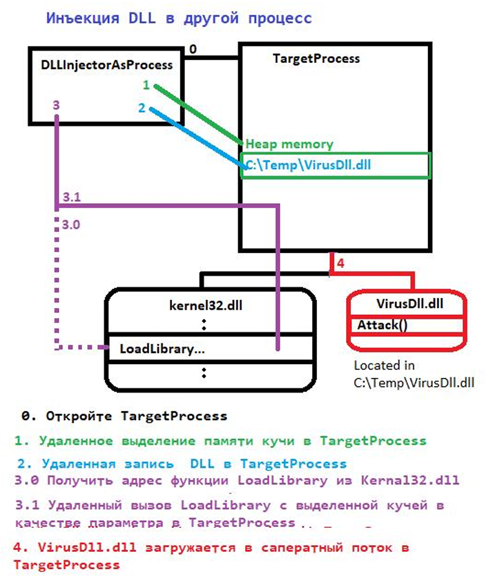

# Лабораторная работа по предмету «Разработка средств защиты информации»
## Тема: «DLL-инъекции в код на C++ и противодействие им»

> 4 курс, 2 семестр
> Студентка группы 932223: **Колупаева Дарья Игоревна**

## 1. Постановка задачи

### Ознакомиться с механизмом инъекции на примере пользовательского проекта

- Проект: https://disk.yandex.ru/d/xgNGbBK37pmMgQ
- Механизм: https://disk.yandex.ru/i/LhhjTMd3mLKS6w

### Реализовать защиту от инъекции

- Защита, вариант 1: https://disk.yandex.ru/i/oj5Lm1NgeCDiZQ

## 2. Структура проекта



```text
├── build/                     — файлы, созданные во время сборки 
│   └── ...                         
│  
│                                                                                          ─┐
├── DllInjectorAsDll/          — инжектор в виде DLL, запускаемый через Rundll32            │    
│   ├── Source.cpp                  — код DLL и экспортируемой функции HelperFunc           │   два варианта
│                                                                                           ├─  запуска  
├── DLLInjectorAsProcess/      — инжектор в виде EXE                                        │   инжектора
│   └── Source.cpp                  — получает PID процесса и загружает в него VirusDLL     │
│                                                                                          ─┘
├── DLLLoader/                 — загружает VirusDLL в собственный процесс
│   └── Source.cpp
│
├── TargetProcess/             — процесс(жертва) каждую секунду выводит счётчик в консоль
│   └── Source.cpp
│
├── VirusDLL/                  — DLL, которую загружают в целевой процесс (окно BOOM!)
│   └── Source.cpp
│
│── .gitignore
│── CMakeLists.txt
│── DLLInjectionLinkedIn.sln   — решение Visual Studio; ссылается на отсутствующие .vcxproj
├── Prize.html                 — демонстрационная HTML-страница
└── README.md                  
```


## 3. Запуск
### Сборка проекта

Выполнить команды из корневой папки проекта:

```powershell
cmake -S . -B build
cmake --build build
```

Чтобы собрать только целевую программу (жертву):

```powershell
cmake --build build --target TargetProcess
```

### Запустить целевой процесс

В первом окне PowerShell запустить целевой процесс:

```powershell
cd build
.\TargetProcess.exe
```

Оставить процесс запущенным. Во втором окне PowerShell, открытом в корневой папке проекта, перейти в `build`, получить PID процесса и запустить инжектор:

```powershell
cd..
Get-Process TargetProcess | Select-Object Id,ProcessName
cd build
.\DLLInjectorAsProcess.exe <PID>
```

При успешной загрузке DLL в целевом процессе должно появиться окно `BOOM!`.

### Остановка процессов и удаление файлов сборки

Выполнить команды из корневой папки проекта:

```powershell
Get-Process TargetProcess -ErrorAction SilentlyContinue | Stop-Process -Force
Remove-Item -Recurse -Force .\build
```